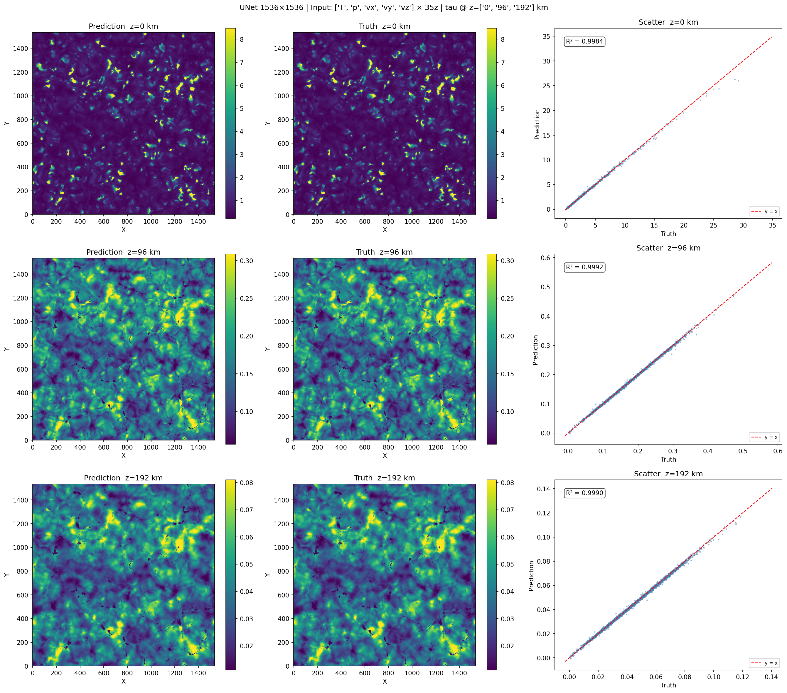
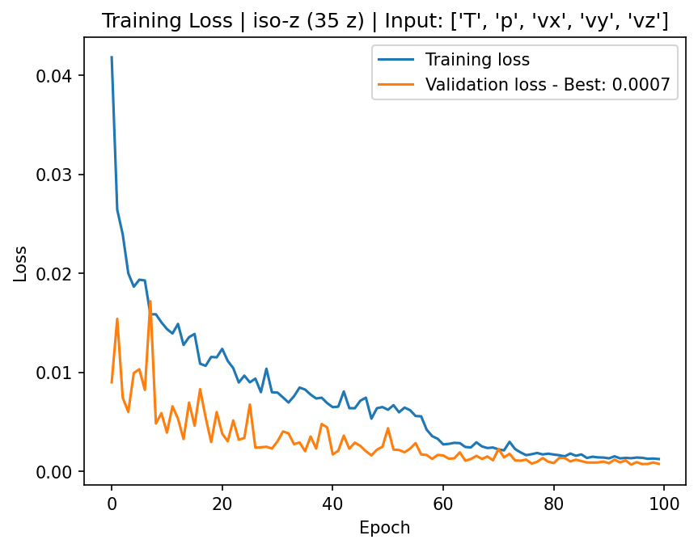
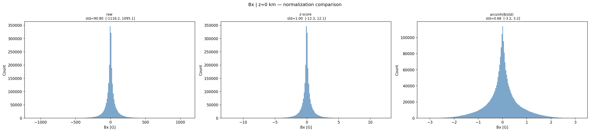
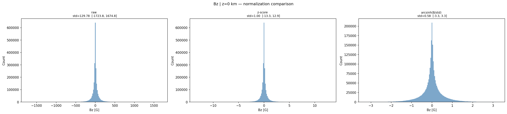
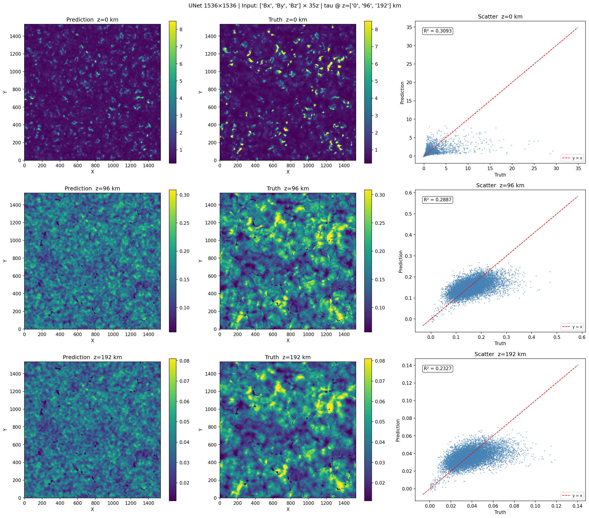

# Reconstructing Solar Corrugation Using Machine Learning

## Data

We use FITS cubes from a MURaM simulation of the solar atmosphere with the following shape:

| Dimension | Size | Description |
|-----------|------|-------------|
| Channels | 9 | 8 physical parameters + 1 z(tau) map |
| Spatial | 1536 × 1536 | Spatial resolution |
| Depth | 35 | Iso-z layers |

## Task

The goal is to train a network on the physical parameters `(8, 1536, 1536, 35)` to predict the z(tau) map `(1, 1536, 1536, 3)`.

In this example we target 3 iso-z layers, **0, 96 and 192 km**, and use 5 input channels: `T, p, v`.

Notebooks are named **`cnn-iso-z-{patch creation type}-{physical parameters used for training}.ipynb`**, e.g. `cnn-iso-z-random-tpv.ipynb`.

> `v` means we used `vx`, `vy` and `vz`. The same applies to `B`.

## Results

### Input T, p, vx, vy and vz

  
   
  <em>Image 1: Reconstruction of the 3 z layers</em>

  
   
  <em>Image 2: Loss values</em>

### Normalization testing

Here we test how the normalization of the magnetic field influences training and prediction when the network is given magnetic inputs only. We compare the z-score $(B - B_{\mathrm{mean}})/\sigma$ with $\mathrm{arcsinh}(B / \sigma)$.

First, the distributions of the magnetic field values at $z = 0$ km:

  
   
  <em>Image 3: Distributions and normalizations of Bx</em>

  
   
  <em>Image 4: Distributions and normalizations of By</em>

  
   
  <em>Image 5: Distributions and normalizations of Bz</em>

Unfortunately, both normalizations give disappointing reconstructions, with `arcsinh` about 1% better than the z-score.
> The reconstruction does work in small regions where the magnetic field has a strong influence.

  
   
  <em>Image 6: Reconstruction using z-score normalization</em>

